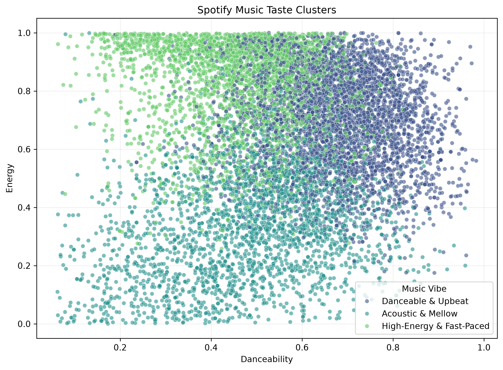

# Spotify Music Taste Clustering & Automated Playlist Generator

An unsupervised Machine Learning project that analyzes Spotify audio features, groups tracks into different music-vibe clusters using K-Means Clustering, and generates automated playlists based on musical characteristics.

## Project Overview

This project uses K-Means Clustering to discover patterns in Spotify tracks based on four numerical audio features:

- Danceability
- Energy
- Acousticness
- Tempo

The goal is to group songs with similar audio characteristics into meaningful music categories and generate playlists automatically.

## Dataset

- **Source:** [Spotify Tracks Dataset – Kaggle](https://www.kaggle.com/datasets/saichaitanyareddyai/spotify-tracks-dataset-audio-features)
- **Original Records:** 114,000
- **Cleaned Records:** 113,392
- **Total Features:** 20

### Data Preprocessing

- Removed duplicate rows.
- Removed records with missing track names or artist names.
- Removed tracks with invalid zero tempo values.
- Selected four numerical features for clustering.
- Applied StandardScaler to normalize the feature values.

## Machine Learning Workflow

1. Data Loading and Exploration
2. Data Cleaning and Preprocessing
3. Feature Selection
4. Feature Scaling using StandardScaler
5. Finding Optimal K using the Elbow Method
6. Evaluating Clusters using Silhouette Scores
7. Training K-Means Clustering Model
8. Cluster Analysis and Vibe Labeling
9. Data Visualization
10. Playlist Generation and Model Export

## Model Selection

Evaluated different cluster counts using the Elbow Method and Silhouette Score.

| Number of Clusters (K) | Silhouette Score |
|---|---:|
| 3 | 0.2736 |
| 4 | 0.2536 |
| 5 | 0.2433 |
| 6 | 0.2504 |

**Selected K = 3**

The final model uses three clusters based on the evaluation results and interpretability.

## Music Vibe Categories

| Cluster | Vibe Label | Characteristics |
|---|---|---|
| 0 | Acoustic & Mellow | Low energy, high acousticness |
| 1 | Danceable & Upbeat | High danceability and energy |
| 2 | High-Energy & Fast-Paced | High energy and faster tempo |

## Visualizations

### Elbow Method


### Music Clusters


## Project Structure

```text
Spotify-Music-Taste-Clustering/
│
├── dataset/
│   └── spotify-tracks-dataset-detailed.csv
│
├── models/
│   └── spotify_kmeans_pipeline.joblib
│
├── notebooks/
│   └── spotify_clustering.ipynb
│
├── outputs/
│   ├── Elbow Method for Optimal K.png
│   └── music_clusters.png
│
├── src/
│   └── main.py
│
├── engineered_playlists.csv
├── requirements.txt
├── .gitignore
└── README.md
```

## Technologies Used

- Python
- Pandas
- NumPy
- Matplotlib
- Seaborn
- Scikit-learn
- K-Means Clustering
- StandardScaler
- Joblib
- Jupyter Notebook

## Installation & Usage

**1. Clone the repository**

```bash
git clone https://github.com/mdraihanmostafa746-coder/Spotify-Music-Taste-Clustering.git
```

**2. Navigate to the project directory**

```bash
cd Spotify-Music-Taste-Clustering
```

**3. Create a virtual environment**

```bash
python -m venv .venv
```

**4. Activate the environment**

macOS / Linux:

```bash
source .venv/bin/activate
```

**5. Install dependencies**

```bash
pip install -r requirements.txt
```

**6. Open the Jupyter Notebook**

```bash
jupyter notebook
```

Open `notebooks/spotify_clustering.ipynb` to explore the complete machine learning workflow.

## Output

The project generates:

- `engineered_playlists.csv` – Tracks with assigned music-vibe labels.
- `models/spotify_kmeans_pipeline.joblib` – Saved scaler, trained K-Means model, feature list, and vibe mapping.
- `outputs/` – Elbow method and music cluster visualizations.

## Limitations

- The clustering model uses only four audio features.
- Silhouette scores indicate moderate cluster separation, so some overlap between music groups is expected.
- Music vibe labels are manually assigned based on cluster feature averages.

## Future Improvements

- Build an interactive web application.
- Develop a FastAPI backend for real-time predictions.
- Create a React-based music exploration dashboard.
- Generate personalized playlists based on user-selected music preferences.
- Deploy the application for public access.

---

**Developed as a Machine Learning project focused on Unsupervised Learning and Music Data Analysis.**